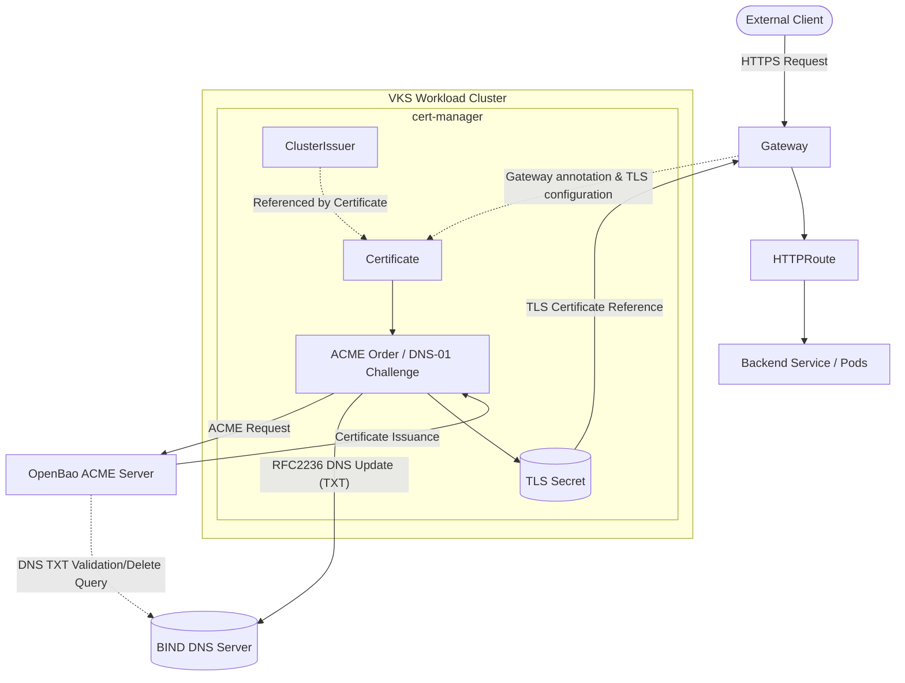

# OpenBao ACME Integration with cert-manager and Automated TLS Certificate Management in an Air-Gapped Lab22 Environment

**Purpose:** A repeatable implementation guide for installing OpenBao on the Lab22 jumpbox, configuring its API TLS certificate and Raft storage, initializing and unsealing it, creating an internal PKI, and integrating it with cert-manager in the Kubernetes cluster.

**Target environment (edit these values if the lab changes):**

| Item | Example value |
|---|---|
| OpenBao host | `lab22` jumpbox |
| OpenBao DNS name | `bao.lab22.sunfire.lab` |
| OpenBao IP | `10.22.99.5` |
| OpenBao API | `https://bao.lab22.sunfire.lab:8200` |
| OpenBao cluster port | `8201/tcp` |
| Internal DNS zone | `vks.lab22.sunfire.lab` |
| Kubernetes namespace for example integration | `travelportal-lab22` |
| Example service hostname | `travelportal.vks.lab22.sunfire.lab` |
| OpenBao version in this procedure | `2.7.1` |
| Storage backend | Single-node Raft |
| ACME role | `lab22-services-acme` |

> **Important:** This guide is for a lab/single-node deployment. A single OpenBao node does not provide host-level high availability or disaster recovery. Replace example IP addresses, DNS names, namespaces, hostnames, and file paths where your lab differs. Confirm commands against the exact OpenBao and cert-manager versions installed in your environment.

## 1. Architecture and traffic flow




## Certificate Provisioning – Component and Object Explanation

The following components work together to automate TLS certificate provisioning using cert-manager, OpenBao ACME, and BIND DNS.

| Object / Component | Description |
|---|---|
| **Gateway** | Entry point for incoming application traffic. Its HTTPS listener defines the hostname, TLS termination mode, and Kubernetes TLS Secret reference. The `cert-manager.io/cluster-issuer` annotation identifies the ClusterIssuer used for certificate provisioning. |
| **Gateway Shim** | cert-manager's Gateway API integration. It watches Gateway resources and automatically creates a Certificate resource based on the Gateway's TLS configuration and issuer annotation. |
| **ClusterIssuer** | A cluster-scoped cert-manager resource that defines the OpenBao ACME directory URL, account email, CA trust bundle, and DNS-01 solver configuration. It can be referenced by Certificates across multiple namespaces. |
| **Certificate** | Defines the desired TLS certificate, including the DNS hostname, issuer reference, and target Kubernetes TLS Secret. It is automatically generated by Gateway Shim in this architecture. |
| **CertificateRequest** | Represents an individual certificate issuance request generated by cert-manager. It connects the Certificate resource to the configured issuer and tracks the issuance process. |
| **ACME Order** | Represents the certificate order created through the ACME protocol. It tracks the requested DNS names and the authorization process required before certificate issuance. |
| **ACME Challenge** | Represents the DNS-01 domain ownership validation challenge. cert-manager processes this resource and coordinates the DNS solver to publish the required TXT record. |
| **RFC2136 DNS Solver** | cert-manager's DNS-01 solver that communicates with BIND DNS using RFC2136 dynamic updates. It creates and subsequently cleans up the `_acme-challenge` TXT record. |
| **BIND DNS Server** | Hosts the DNS zone and accepts authenticated dynamic DNS updates from cert-manager. OpenBao performs DNS resolution to verify the expected TXT record during domain ownership validation. |
| **OpenBao ACME Server** | Provides the ACME directory and handles ACME account registration, order processing, DNS challenge validation, and certificate issuance using its PKI engine and configured ACME role. |
| **Kubernetes TLS Secret** | Stores the issued TLS certificate and corresponding private key. The Secret name matches the `certificateRefs` configured in the Gateway listener. |
| **Gateway Controller (Istio)** | Implements the Gateway resource, configures the HTTPS listener, consumes the TLS Secret, and handles TLS termination for incoming application traffic. |
| **HTTPRoute** | Defines application traffic routing rules, such as hostname and path matching, and forwards requests to the appropriate backend Service. |
| **Backend Service / Pods** | The Service provides a stable endpoint for the application Pods, which process incoming application requests. |

### Certificate Provisioning Sequence

1. Gateway is created with an HTTPS listener and ClusterIssuer annotation.
2. Gateway Shim detects the configuration and automatically creates a Certificate.
3. cert-manager creates a CertificateRequest and initiates the ACME workflow.
4. cert-manager communicates with OpenBao and creates an ACME Order.
5. OpenBao provides the DNS-01 challenge.
6. cert-manager's RFC2136 solver creates the DNS TXT record in BIND.
7. OpenBao validates DNS ownership.
8. OpenBao issues the certificate after successful validation.
9. cert-manager stores the certificate and private key in the Kubernetes TLS Secret.
10. The Gateway controller consumes the Secret and enables HTTPS termination.

**Note:** Gateway Shim automates Certificate resource creation. cert-manager handles the ACME workflow and DNS-01 challenge processing, while OpenBao is responsible for domain validation and certificate issuance.

## 2. Pre-implementation checklist

Before starting, confirm:

- [ ] You have administrator/root access on the Lab22 jumpbox.
- [ ] The OpenBao archive `openbao_2.7.1_linux_amd64.tar.gz` has been transferred into the air-gapped environment through your approved process.
- [ ] The archive checksum/signature has been verified against a trusted value obtained before the transfer, if your release process provides one.
- [ ] The jumpbox IP `10.22.99.5` is correct and static.
- [ ] DNS has an A record for `bao.lab22.sunfire.lab` pointing to `10.22.99.5`.
- [ ] The jumpbox can resolve its own OpenBao DNS name.
- [ ] Required firewall rules allow clients to reach TCP `8200`; TCP `8201` is allowed only where cluster traffic is required.
- [ ] The Kubernetes cluster can resolve and reach `bao.lab22.sunfire.lab:8200`.
- [ ] The installed cert-manager version and its Vault issuer/clusterissuer CRD schema have been checked before applying the Issuer manifest.
- [ ] A secure location is available for the unseal key, initial root token, CA material, and generated PKI token. Do not store these in Git.

### 2.1 Confirm DNS and network reachability

Run on the jumpbox:

```bash
hostname -f
ip address
getent hosts bao.lab22.sunfire.lab
ss -lntp | grep -E ':8200|:8201' || true
```

If DNS is not configured yet, create the appropriate A record in your lab DNS server. For a temporary diagnostic only, you may use a hosts-file entry, but a hosts-file entry is not a substitute for the intended DNS configuration. Ensure the Kubernetes nodes/pods can resolve the name too.

From a Kubernetes node or an approved diagnostic pod, test DNS and TCP reachability using the tools available in that environment. Do not assume that a successful test from the jumpbox proves that the cluster can reach OpenBao.

## 3. Install the OpenBao binary

### 3.1 Extract the air-gapped archive

Change to the directory where the archive was transferred. The example assumes the archive is in the current directory.

```bash
tar -xzf openbao_2.7.1_linux_amd64.tar.gz
```

Check the extracted files:

```bash
ls -l
```

Confirm that the extracted binary is named `bao` before installing it.

### 3.2 Install the binary and verify the version

```bash
install -o root -g root -m 0755 bao /usr/local/bin/bao
ls -l /usr/local/bin/bao
bao version
```

Expected version should identify OpenBao `v2.7.1` for this example. If a different version is shown, stop and confirm that the correct archive was used.

## 4. Create directories and permissions

Create the configuration, data, and TLS directories:

```bash
mkdir -p /etc/openbao
mkdir -p /var/lib/openbao
mkdir -p /etc/openbao/tls
```

Confirm they exist:

```bash
ls -ld /etc/openbao /var/lib/openbao /etc/openbao/tls
```

The commands below use a root-owned service for simplicity in this lab. For a hardened deployment, create a dedicated `openbao` system user and group, transfer ownership of the data/configuration/TLS paths appropriately, and run the service under that account. Do not switch the service user without also adjusting file ownership and permissions.

## 5. Create the OpenBao API TLS certificate

This self-signed certificate secures the OpenBao API endpoint. It is **not** the PKI root CA used to sign application certificates later.

### 5.1 Generate the certificate and private key

```bash
cd /etc/openbao/tls

openssl req -x509 -nodes -newkey rsa:3072 \
  -keyout bao.key \
  -out bao.crt \
  -days 365 \
  -subj "/CN=bao.lab22.sunfire.lab" \
  -addext "subjectAltName=DNS:bao.lab22.sunfire.lab,IP:10.22.99.5"
```

The Subject Alternative Name (SAN) includes both the DNS name and IP address. If clients connect using a different hostname or IP, add that name/IP to the SAN before generating the certificate.

### 5.2 Set permissions and validate the certificate

```bash
chmod 0644 /etc/openbao/tls/bao.crt
chmod 0600 /etc/openbao/tls/bao.key

openssl x509 -in /etc/openbao/tls/bao.crt \
  -noout -subject -issuer -dates -ext subjectAltName
```

Keep the private key (`bao.key`) protected. Never commit it to Git or distribute it unnecessarily.

## 6. Configure OpenBao

Create `/etc/openbao/openbao.hcl`:

```bash
cat > /etc/openbao/openbao.hcl <<'EOF'
ui = true

api_addr = "https://bao.lab22.sunfire.lab:8200"
cluster_addr = "https://10.22.99.5:8201"

disable_mlock = true

storage "raft" {
  path    = "/var/lib/openbao"
  node_id = "lab22-openbao-1"
}

listener "tcp" {
  address         = "10.22.99.5:8200"
  cluster_address = "10.22.99.5:8201"
  tls_cert_file   = "/etc/openbao/tls/bao.crt"
  tls_key_file    = "/etc/openbao/tls/bao.key"
}
EOF
```

### 6.1 What the main settings mean

- `ui = true`: enables the web UI.
- `api_addr`: canonical API address clients should use.
- `cluster_addr`: address advertised for cluster communication.
- `disable_mlock = true`: disables memory locking. This is a practical lab setting, not a universal production recommendation; follow the security guidance for your operating system and deployment.
- `storage "raft"`: stores OpenBao data locally under `/var/lib/openbao`.
- `node_id`: unique identifier for this Raft node. If more nodes are added, each must have a unique ID and the cluster must be configured correctly.
- `listener "tcp"`: listens on the specified IP and ports and presents the API TLS certificate.

**Single-node note:** Raft is configured here, but a single node is not redundant. Back up the Raft data and configuration using a tested, version-appropriate backup procedure.

### 6.2 Verify configuration file and permissions

```bash
chmod 0644 /etc/openbao/openbao.hcl
ls -l /etc/openbao/openbao.hcl
```

Check the paths and IP address in the file before starting the service.

## 7. Create the systemd service

Create `/etc/systemd/system/openbao.service`:

```bash
cat > /etc/systemd/system/openbao.service <<'EOF'
[Unit]
Description=OpenBao Secrets Management Server
Documentation=https://openbao.org/docs/
After=network-online.target
Wants=network-online.target

[Service]
User=root
Group=root
ExecStart=/usr/local/bin/bao server -config=/etc/openbao/openbao.hcl
ExecReload=/bin/kill --signal HUP $MAINPID
Restart=on-failure
RestartSec=5
LimitNOFILE=65536
NoNewPrivileges=true
PrivateTmp=true
ProtectHome=true

[Install]
WantedBy=multi-user.target
EOF
```

Reload systemd, enable OpenBao at boot, and start it:

```bash
systemctl daemon-reload
systemctl enable --now openbao
systemctl status openbao --no-pager
```

If the service fails, inspect the logs before continuing:

```bash
journalctl -u openbao -n 100 --no-pager
```

Common causes include an incorrect IP address, unreadable TLS key, invalid HCL syntax, occupied port, or a missing binary.

## 8. Verify API access and TLS

Set the CLI environment variables in the shell where you will run the OpenBao CLI:

```bash
export BAO_ADDR="https://bao.lab22.sunfire.lab:8200"
export BAO_CACERT="/etc/openbao/tls/bao.crt"
```

These variables do not persist across new shell sessions unless you put them in a suitable protected shell profile. The `BAO_CACERT` path must exist on the machine running the CLI. Kubernetes clients will need their own trusted copy/configuration of the API certificate.

Test the health endpoint:

```bash
curl --cacert /etc/openbao/tls/bao.crt \
  https://bao.lab22.sunfire.lab:8200/v1/sys/health
```

The HTTP status and JSON response depend on whether OpenBao is initialized, sealed, and active. A response indicating that the service is sealed or not initialized is expected at this stage. A TLS hostname/SAN error means the client hostname does not match the certificate; use `bao.lab22.sunfire.lab` or regenerate the certificate with the intended SAN. Do not use `curl -k` as the permanent fix.

## 9. Initialize OpenBao

> **Critical:** Initialize OpenBao only once for this data directory. Do not run `bao operator init` again on an already initialized instance.

Use one key share and one required key for this simple lab setup:

```bash
bao operator init -key-shares=1 -key-threshold=1
```

The output contains an unseal key and an initial root token. Values are unique to your installation and must never be copied into this guide, a ticket, a screenshot, or a Git repository.

Immediately:
1. Store the unseal key in an approved secure location, separate from the OpenBao host where practical.
2. Store the initial root token in a secure password/secret vault.
3. Limit access to both values.
4. Do not continue if you cannot securely retain the unseal key.

The `-key-shares=1 -key-threshold=1` options mean one key share is generated and one share is required to unseal. This is convenient for a lab but has weaker separation of duties than a multi-share setup.

## 10. Unseal and authenticate

### 10.1 Unseal OpenBao

```bash
bao operator unseal
```

Paste the unseal key when prompted. Do not place the real key directly into a command, shell history, documentation, or automation log.

### 10.2 Log in with the initial root token

```bash
bao login
```

Paste the initial root token when prompted. Avoid putting tokens directly in command arguments because they can be exposed in shell history or process listings.

### 10.3 Check the seal status

```bash
bao status
```

Confirm that `Initialized` is `true` and `Sealed` is `false`. The cluster name, cluster ID, timestamps, and Raft indexes will be generated by your own instance and will differ from any example output.

## 11. Enable and configure the internal PKI secrets engine

This PKI is used to issue internal service certificates. It is separate from the self-signed API TLS certificate created in Section 5.

### 11.1 Enable PKI and set the maximum lease TTL

```bash
bao secrets enable pki
bao secrets tune -max-lease-ttl=87600h pki
```

`87600h` is approximately ten years. Choose a root CA lifetime appropriate to your organization’s security policy. Long-lived root CAs need strong protection and planned rotation.

### 11.2 Generate an internal root CA

```bash
bao write pki/root/generate/internal \
  common_name="Lab22 Internal Root CA" \
  issuer_name="lab22-root" \
  ttl=87600h
```

The command creates the internal root CA within OpenBao. The private key remains managed by OpenBao; do not attempt to export or publish it.

### 11.3 Configure issuing and CRL URLs

```bash
bao write pki/config/urls \
  issuing_certificates="https://bao.lab22.sunfire.lab:8200/v1/pki/ca" \
  crl_distribution_points="https://bao.lab22.sunfire.lab:8200/v1/pki/crl"
```

These URLs advertise where clients can retrieve the CA certificate and certificate revocation list. They must be reachable and use a hostname that matches the API TLS certificate.

### 11.4  Export the public internal root CA certificate

Create a protected directory and export only the public certificate:

```bash
mkdir -p /root/openbao-pki
chmod 0700 /root/openbao-pki

bao read -field=certificate pki/cert/ca \
  > /root/openbao-pki/lab22-root-ca.crt

openssl x509 -in /root/openbao-pki/lab22-root-ca.crt \
  -noout -subject -issuer -dates
```

This file contains the public CA certificate, not the CA private key. Distribute it only through an approved trust-distribution process. Keep it distinct from `/etc/openbao/tls/bao.crt`, which is the self-signed certificate for the OpenBao API endpoint.

## 12 Create a ACME role for lab service certificates

```bash
bao write pki/roles/lab22-services-acme \
  allowed_domains="lab22.sunfire.lab" \
  allow_bare_domains=true \
  allow_subdomains=true \
  allow_wildcard_certificates=false \
  allow_ip_sans=false \
  max_ttl=720h \
  no_store=false
```

This role allows certificates for names within `lab22.sunfire.lab` and its subdomains, with a maximum TTL of 720 hours (30 days). Tighten the allowed domain and other role options to match your security requirements. Do not broaden the role to arbitrary domains.

Verify the role:

```bash
bao read pki/roles/lab22-services-acme
```

### 12.1 — Enable ACME on the PKI mount


You need to configure the PKI mount's cluster path first, then retry pki/config/acme.

Configure the PKI cluster path
Since your OpenBao endpoint is bao.lab22.sunfire.lab, run:
```bash
bao write pki/config/cluster \
  path="https://bao.lab22.sunfire.lab:8200/v1/pki"
```

The path must point to the externally reachable, TLS-enabled URL for this PKI mount. If you use a load balancer or another DNS name for OpenBao, use that address instead. 

Verify the configuration
```bash
bao read pki/config/cluster
```
You should see:
```bash
Key         Value
---         -----
aia_path    n/a
path        https://bao.lab22.sunfire.lab:8200/v1/pki
```
### 12.2 Configure OpenBao ACME using the ACME role we created above:
```bash
bao write pki/config/acme \
  enabled=true \
  allowed_roles=lab22-services-acme \
  default_directory_policy=forbid \
  eab_policy=always-required
```
Verify:
```bash
bao read pki/config/acme
```
Output:
```bash
Key                         Value
---                         -----
allow_role_ext_key_usage    false
allowed_issuers             [*]
allowed_roles               [lab22-services-acme]
default_directory_policy    forbid
dns_resolver                n/a
eab_policy                  always-required
enabled                     true
```

### 12.3 Your ACME directory URL is:
```bash
https://bao.lab22.sunfire.lab:8200/v1/pki/roles/lab22-services-acme/acme/directory
```
Test that the directory is accessible:
```bash
curl --cacert /etc/openbao/tls/bao.crt \
  https://bao.lab22.sunfire.lab:8200/v1/pki/roles/lab22-services-acme/acme/directory
 ```
 ```
Output:
{"keyChange":"https://bao.lab22.sunfire.lab:8200/v1/pki/roles/lab22-services-acme/acme/key-change","meta":{"externalAccountRequired":true},"newAccount":"https://bao.lab22.sunfire.lab:8200/v1/pki/roles/lab22-services-acme/acme/new-account","newNonce":"https://bao.lab22.sunfire.lab:8200/v1/pki/roles/lab22-services-acme/acme/new-nonce","newOrder":"https://bao.lab22.sunfire.lab:8200/v1/pki/roles/lab22-services-acme/acme/new-order","revokeCert":"https://bao.lab22.sunfire.lab:8200/v1/pki/roles/lab22-services-acme/acme/revoke-cert"}
```

### 12.4 You should receive an ACME directory JSON response.

Important — ACME response headers: OpenBao requires the ACME response headers Replay-Nonce, Link, and Location to be permitted by the PKI mount. Check the mount's current settings and ensure these headers are included. Preserve any existing allowed headers when updating the list.
```bash
curl -sSI --cacert /etc/openbao/tls/bao.crt   https://bao.lab22.sunfire.lab:8200/v1/pki/roles/lab22-services-acme/acme/new-nonce
```
If the header do not return Reply-Nonce, tune it with below command.

Configure the required headers
```bash
bao secrets tune \
  -allowed-response-headers="Replay-Nonce" \
  -allowed-response-headers="Link" \
  -allowed-response-headers="Location" \
  pki/
```

Verify the configuration
```bash
bao read -format=json sys/mounts/pki/tune | jq '.data.allowed_response_headers'
```
```
Output:-
Expected output:
[
  "Replay-Nonce",
  "Link",
  "Location"
]
```

## 13 Configure BIND for cert-manager DNS01

Your existing DNS configuration:

### DNS Configuration

| Parameter | Value | Description |
|---|---|---|
| DNS Server | `10.22.99.5` | BIND DNS server IP address |
| DNS Zone | `vks.lab22.sunfire.lab` | DNS zone where TXT records are created |
| Existing ExternalDNS TSIG Key | `externaldns-key` | Authentication key used by ExternalDNS |
| New cert-manager TSIG Key | `certmanager-acme` | Dedicated authentication key for cert-manager DNS-01 challenges |

We will retain the ExternalDNS key and add a separate TSIG key for cert-manager.

### 13.1 Generate the cert-manager TSIG key

On the BIND server:

tsig-keygen -a hmac-sha256 certmanager-acme
key "certmanager-acme" {
        algorithm hmac-sha256;
        secret "RzBsOraf4CB/NXNAoFG+GTShVMMO8wljV4GlzXCtIug=";
};
Save this output to:
/etc/named/keys/certmanager-acme.key

Protect the file:
chmod 640 /etc/named/keys/certmanager-acme.key
chown root:named /etc/named/keys/certmanager-acme.key

Use the actual group and directory permissions appropriate for your BIND installation.

### 13.2 Include both TSIG keys in named.conf
Make sure both keys are included:
```
include "/etc/named/keys/externaldns.key";
include "/etc/named/keys/certmanager-acme.key";
```
Keep your existing ExternalDNS key definition unchanged.
4.3 Update the zone's dynamic update policy
In your BIND zone configuration, use:
```
zone "vks.lab22.sunfire.lab" IN {
    type master;
    file "vks.lab22.sunfire.lab.zone";

    update-policy {
        grant externaldns-key zonesub ANY;
        grant certmanager-acme zonesub TXT;                                          #Used by 'cert-manager' with only TXT update privilege 
    };

    allow-transfer {
        key "externaldns-key";
    };
};
```
This gives:
- ExternalDNS its existing zone-wide update permissions.
- cert-manager permission to add and remove ACME TXT record.

Important: allow-update and update-policy cannot both be specified in the same zone.

### 13.3 Validate and reload BIND
named-checkconf

named-checkzone lab22.sunfire.lab \
  /var/named/vks.lab22.sunfire.lab.zone

Use the actual zone file path from your configuration.

If validation succeeds:
```
systemctl reload named
```
### 14 Test the BIND update before involving cert-manager

#### 14.1 Create a test update file:
```
cat >/tmp/test-update.txt <<'EOF'
server 10.22.99.5
zone vks.lab22.sunfire.lab
update add _acme-challenge.testing.vks.lab22.sunfire.lab 60 TXT "test"
send
EOF
```
Run:
```
nsupdate -k /etc/named/keys/certmanager-acme.key \
  /tmp/test-update.txt
```

Check the TXT record:
```
dig @10.22.99.5 TXT _acme-challenge.testing.vks.lab22.sunfire.lab

or duplicate the linux session and run below command 

watch -n 1 dig -k /etc/named/keys/externaldns.key @10.22.99.5 vks.lab22.sunfire.lab AXFR
```

#### 14.2 Delete the test record:
cat >/tmp/test-delete.txt <<'EOF'
server 10.22.99.5
zone vks.lab22.sunfire.lab
update delete _acme-challenge.testing.vks.lab22.sunfire.lab TXT
send
EOF
```
nsupdate -k /etc/named/keys/certmanager-acme.key \
  /tmp/test-delete.txt
```
Check the TXT record:
```
dig @10.22.99.5 TXT _acme-challenge.testing.vks.lab22.sunfire.lab

or duplicate the linux session and run below command 

watch -n 1 dig -k /etc/named/keys/externaldns.key @10.22.99.5 vks.lab22.sunfire.lab AXFR
```
Verify it is gone: SERVFAIL means doesn't exist.

Do not proceed until the TSIG update and delete operations both work. cert-manager uses the same dynamic DNS mechanism. 
cert-manager Documentation


## 15. Prepare Kubernetes integration

The examples below use namespace `travelportal-lab22`. 

### 15.1 Confirm cert-manager is installed and discover the Vault issuer schema

```bash
kubectl get pods -A | grep -i cert-manager
kubectl get crd | grep -E 'issuers.cert-manager.io|clusterissuers.cert-manager.io'
```
### 15.2 Create Kubernetes secrets

There are two credentials cert-manager needs:
1. BIND TSIG secret(TOKEN) — to create DNS challenge records.
2. OpenBao EAB secret — to register its ACME account.

Both will be stored in the cert-manager namespace because we are creating a ClusterIssuer.

### 15.2.1 Create the BIND TSIG secret
Extract the secret value from:
cat /etc/named/keys/certmanager-acme.key
```
key "certmanager-acme" {
        algorithm hmac-sha256;
        secret "RzBsOraf4CB/NXNAoFG+GTShVMMO8wljV4GlzXCtIug=";
};
```
It is the value inside the secret field.

Create the Kubernetes Secret:
```
kubectl create secret generic certmanager-bind-tsig \
  -n cert-manager \
  --from-literal=tsig-secret='RzBsOraf4CB/NXNAoFG+GTShVMMO8wljV4GlzXCtIug='
```
Verify:
```
kubectl get secret certmanager-bind-tsig -n cert-manager
```

Do not Base64-encode the value yourself when using --from-literal; Kubernetes handles that.

### 15.2.2 Generate the OpenBao EAB - "externalAccountBinding" credentials
On the OpenBao server, execute:
```
bao write -f pki/roles/lab22-services-acme/acme/new-eab
```
Output:
```
Key               Value
---               -----
acme_directory    roles/lab22-services-acme/acme/directory
created_on        2026-11-04T14:14:30+05:30
id                6ec4476a-fea8-dda1-aa07-8f307da750cc
key               vault-eab-0-7aBarmA6_T2ohKLhjlmoqBfHEOzutnIaRUUqFJRpP6c
key_type          hs
```
The output should contain an EAB key ID(id) and HMAC key(key). Keep both values secure.

The EAB must be generated for the service-acme directory, which is the directory configured in the ClusterIssuer below. 

Convert the returned HMAC key to Base64URL format:
```
EAB_KEY='vault-eab-0-7aBarmA6_T2ohKLhjlmoqBfHEOzutnIaRUUqFJRpP6c'           #vault-eab-0-7aBarmA6_T2ohKLhjlmoqBfHEOzutnIaRUUqFJRpP6c

EAB_KEY_B64URL=$(printf '%s' "$EAB_KEY" |
  tr '+/' '-_' |
  tr -d '=')
```
Important: Above commands does not actually perform Base64 encoding. It only converts an already Base64-encoded value into Base64URL-compatible form.

Create the EAB secret:
```
kubectl create secret generic services-openbao-eab \
  -n cert-manager \
  --from-literal=secret="$EAB_KEY_B64URL"
```

Verify:
```
kubectl get secret services-openbao-eab -n cert-manager
```

### 15.2.3 If the OpenBao API SSL certificate is self-signed, use that certificate as the trust anchor.

Encode it: We will refer output of below command inside "Issuer/ClusterIssuer" yaml
```
base64 -w0 /etc/openbao/tls/bao.crt
```
Copy the resulting Base64 string. We will use it as caBundle in the ClusterIssuer/Issuer.

## 16 Create the ACME ClusterIssuer
Create: "openbao-acme-clusterissuer.yaml"
```yaml
apiVersion: cert-manager.io/v1
kind: ClusterIssuer
metadata:
  name: openbao-acme-clusterissuer
spec:
  acme:
    email: <EMAIL_ADDRESS>       #Enter email address "omkar.shinde@sunfire.in  "

    server: https://bao.lab21.sunfire.lab:8200/v1/pki/roles/lab21-services-acme/acme/directory    #Update the Openbao ACME URL

    caBundle: <BASE64_ENCODED_OPENBAO_SSL_STRING>       #Output of step 15.2.3

    privateKeySecretRef:
      name: openbao-acme-account-key           #cert-manager automatically creates and manages it when the ClusterIssuer registers an ACME account with OpenBao.

    externalAccountBinding:
      keyID: 6ec4476a-fea8-dda1-aa07-8f307da750cc     #Find the keyID from EAB credential creation output
      keySecretRef:
        name: services-openbao-eab          #Refer the EAB "key" secret
        key: secret

    solvers:
      - dns01:
          rfc2136:
            nameserver: 10.21.99.5:53        #BIND server IP
            tsigKeyName: certmanager-acme
            tsigAlgorithm: HMACSHA256
            tsigSecretSecretRef:
              name: certmanager-bind-tsig     #Refer the "certmanager-bind-tsig" secret used for ACME
              key: tsig-secret
```
Note: Similar object definition for Issuer object

Check:
```
kubectl get clusterissuer openbao-acme-clusterissuer
kubectl describe clusterissuer openbao-acme-clusterissuer
```
cert-manager automatically generates and stores its ACME account private key in service-acme-account-key. You do not need to create that Secret manually. The EAB Secret and account private key serve different purposes

Expected:
READY   True

## 17. Request a service certificate

### 17.1 "Gateway" object creating certificate for application

Prerequisite: Gateway API support must be enabled in cert-manager (enableGatewayAPI: true), and the cert-manager Gateway integration must be installed/configured.
```
kubectl get configmap cert-manager -n cert-manager -o yaml | grep -m 1 'enableGatewayAPI'
Output:
    enableGatewayAPI: true
```
It's called cert-manager Gateway API integration (also known as Gateway Shim).
It automatically detects the Gateway annotation and generates a Kubernetes Certificate resource based on the Gateway's TLS configuration.

#### In our case, the flow is:
```
Gateway annotation → Gateway Shim → Certificate → ClusterIssuer/Issuer → ACME (OpenBao) → Secret
``` 
Create 'travelportal-gateway.yaml'
```yaml
apiVersion: gateway.networking.k8s.io/v1
kind: Gateway
metadata:
  name: travelportal-gateway
  namespace: travelportal-lab21
  annotations:
    cert-manager.io/cluster-issuer: openbao-acme-clusterissuer     #Gateway Shim
    cert-manager.io/renew-before: "120h"                           #Optional: explicit "renewBefore" value can be provided like this or cert-manger renews at approximately 2/3 of the certificate's lifetime
spec:
  gatewayClassName: istio
  listeners:
  - name: https
    hostname: <APP_DOMAIN>       # Example travelportal.vks.lab22.sunfire.lab
    port: 443
    protocol: HTTPS
    tls:
      mode: Terminate
      certificateRefs:
      - kind: Secret
        name: travelportal-acme-tls-secret      # "Certificate" and "Secret" automatically created by the ClusterIssuer,cert-manager & openbao using name provided here.
    allowedRoutes:
      namespaces:
        from: All
```
Apply and validate:

```bash
kubectl apply -f travelportal-gatewayt.yaml
kubectl describe gateway travelportal-gateway -n travelportal-lab22
```

### 17.2 Manually creating certificate for application
Create `travelportal-openbao-cert.yaml`. This example requests a certificate for `travelportal.lab22.sunfire.lab`; replace it with the actual hostname that DNS and the service configuration will use.

```yaml
apiVersion: cert-manager.io/v1
kind: Certificate
metadata:
  name: travelportal-openbao-cert
  namespace: travelportal-lab22
spec:
  secretName: travelportal-tls-secret
  renewBefore: 360h                           #explicit "renewBefore" value can be provided like this or cert-manger will use default value
  issuerRef:
    name: openbao-acme-clusterissuer         #Refer clusterissuer
    kind: ClusterIssuer
  commonName: <APP_DOMAIN>                   #Example travelportal.vks.lab22.sunfire.lab      
  dnsNames: 
    - <APP_DOMAIN>                           # Example travelportal.vks.lab22.sunfire.lab                 
```

Apply and validate:

```bash
kubectl apply -f travelportal-openbao-cert.yaml
kubectl describe certificate travelportal-openbao-cert -n travelportal-lab22
kubectl get certificaterequest,orders,challenges -n travelportal-lab22
kubectl get secret travelportal-tls-secret -n travelportal-lab22
```

Wait for the Certificate to report `Ready=True`. The generated Secret should contain `tls.crt` and `tls.key`. Verify the issued certificate from a trusted environment, for example by extracting the public certificate through an approved process and inspecting its subject, SANs, and validity dates. Do not print or expose the private key.

The certificate is issued by the internal OpenBao PKI. Clients that connect to the service must trust `/root/openbao-pki/lab22-root-ca.crt` (or the approved distributed copy) to validate that service certificate. This is separate from trusting the OpenBao API certificate.

## 18. Restart and unseal procedure for Openbao

With Shamir sealing and no auto-unseal provider configured, OpenBao will normally be sealed after a service restart or host reboot. The operator must unseal it using the saved unseal key.

### 18.1 Start/check the service

```bash
systemctl status openbao --no-pager
journalctl -u openbao -n 100 --no-pager
```

### 18.2 Set CLI environment variables and unseal

```bash
export BAO_ADDR="https://bao.lab22.sunfire.lab:8200"
export BAO_CACERT="/etc/openbao/tls/bao.crt"

bao operator unseal
bao status
```

Enter the saved unseal key only at the prompt. Confirm `Sealed` is `false`. Do not re-run `bao operator init` after a restart.

## 19. Troubleshooting guide

| Symptom | Checks and corrective action |
|---|---|
| `bao: command not found` | Run `ls -l /usr/local/bin/bao`; check `PATH`; reinstall the correct binary if needed. |
| systemd service fails | Run `systemctl status openbao --no-pager` and `journalctl -u openbao -n 100 --no-pager`; verify HCL syntax, paths, permissions, IP, and port availability. |
| DNS name does not resolve | Run `getent hosts bao.lab22.sunfire.lab`; correct the DNS A record and verify resolution from Kubernetes too. |
| TLS hostname/SAN mismatch | Connect using `bao.lab22.sunfire.lab`, or regenerate the certificate with the required DNS/IP SAN and restart OpenBao. |
| TLS unknown authority | Configure the client to trust the exact OpenBao API certificate/CA. Do not use `curl -k` as the permanent solution. |
| Port 8200/8201 unavailable | Run `ss -lntp | grep -E ':8200|:8201'`; check firewall rules and whether another process owns the port. |
| OpenBao is sealed | Run `bao status`, then `bao operator unseal` using the protected unseal key. |
| Issuer is not Ready | Describe the Issuer; verify server URL, DNS/network, API CA bundle, token Secret, token policy, and PKI signing path. |
| Certificate request fails | Describe the Certificate and CertificateRequest; inspect namespace Events and cert-manager logs; verify requested DNS name is allowed by the PKI role. |
| `caBundle` rejected by API | Check `kubectl explain issuer.spec.vault` and the installed cert-manager CRD; use only a field supported by that version. |
| Token has expired or was revoked | Create a replacement token with the correct policy, update the Secret securely, confirm issuance, and revoke the old token when safe. |
| Certificate is issued but clients reject it | Install/trust the internal PKI root CA (`lab22-root-ca.crt`) in the client trust store; do not confuse it with `bao.crt`. |

Useful diagnostic commands:

```bash
# OpenBao service and recent logs
systemctl status openbao --no-pager
journalctl -u openbao -n 100 --no-pager

# DNS and listeners
getent hosts bao.lab22.sunfire.lab
ss -lntp | grep -E ':8200|:8201' || true

# OpenBao status (after setting BAO_ADDR and BAO_CACERT)
bao status

# cert-manager resources and recent events
kubectl get issuer,certificate -n travelportal-lab22
kubectl get certificaterequests -n travelportal-lab22
kubectl get events -n travelportal-lab22 --sort-by=.metadata.creationTimestamp
```

## 21. Security, backup, and operational notes

- Do not commit unseal keys, root tokens, service tokens, private keys, populated Secret manifests, or OpenBao data files to Git.
- Keep the initial root token for controlled administration only. Do not use it for cert-manager.
- Store unseal material securely and test recovery procedures. Losing the required unseal key can make encrypted data unrecoverable.
- A single-node deployment is a single point of failure. Plan tested Raft snapshots/backups and a restore procedure appropriate to the installed OpenBao version.
- The systemd unit above runs as root for a simple lab. For a hardened environment, use a dedicated service account, least-privilege file permissions, appropriate Linux capabilities, and your organization's service-hardening baseline.
- `disable_mlock = true` is a lab choice; assess memory-locking and swap protections for the target OS.
- Set a clear process for token rotation, certificate expiry monitoring, CA rotation, and revocation.
- Confirm firewall access is limited to required clients. Port `8200` is the API/UI; port `8201` is for cluster communication.
- DNS is not created automatically by OpenBao. Create the relevant DNS records through the lab DNS/ExternalDNS workflow.
- The OpenBao API certificate and internal PKI root CA are different trust objects and must be distributed to the right clients for the right purpose.
- This guide does not configure auto-unseal, audit devices, a multi-node Raft cluster, or automated backup. Add these before treating the service as production-ready.

## 22. Final implementation checklist

- [ ] Correct OpenBao archive transferred and verified.
- [ ] Binary installed and version confirmed.
- [ ] `/etc/openbao`, `/var/lib/openbao`, and `/etc/openbao/tls` created.
- [ ] DNS `bao.lab22.sunfire.lab` resolves to `10.22.99.5`.
- [ ] API certificate SAN contains the DNS name used by clients.
- [ ] `/etc/openbao/openbao.hcl` reviewed and saved.
- [ ] systemd service enabled and running.
- [ ] API TLS and health endpoint tested.
- [ ] OpenBao initialized exactly once.
- [ ] Unseal key and initial root token stored securely.
- [ ] OpenBao unsealed and `bao status` checked.
- [ ] PKI engine enabled and root CA created.
- [ ] PKI URLs and `lab22-services` role configured.
- [ ] Public internal root CA exported and inspected.
- [ ] `services-pki` policy created and verified.
- [ ] Scoped token generated and stored securely.
- [ ] cert-manager Vault issuer schema checked for the installed version.
- [ ] Kubernetes API CA and token Secret created securely.
- [ ] Issuer reports `Ready=True`.
- [ ] Certificate reports `Ready=True` and Secret contains `tls.crt`/`tls.key`.
- [ ] Service clients trust the internal PKI root CA.
- [ ] Restart/unseal and recovery procedure tested.
- [ ] Backup, token rotation, certificate renewal, and monitoring ownership assigned.

## 23. Reference commands: fresh install sequence

Use this as a quick index only after reading the detailed sections above. It is not a replacement for storing the generated unseal key/token securely or checking each command's result.

```bash
# Install binary
tar -xzf openbao_2.7.1_linux_amd64.tar.gz
install -o root -g root -m 0755 bao /usr/local/bin/bao
bao version

# Create directories
mkdir -p /etc/openbao /var/lib/openbao /etc/openbao/tls

# Generate API TLS certificate
cd /etc/openbao/tls
openssl req -x509 -nodes -newkey rsa:3072 -keyout bao.key -out bao.crt -days 365 -subj "/CN=bao.lab22.sunfire.lab" -addext "subjectAltName=DNS:bao.lab22.sunfire.lab,IP:10.22.99.5"
chmod 0644 bao.crt
chmod 0600 bao.key

# After writing and reviewing /etc/openbao/openbao.hcl and the systemd unit:
systemctl daemon-reload
systemctl enable --now openbao
systemctl status openbao --no-pager

# Set CLI endpoint and trust
export BAO_ADDR="https://bao.lab22.sunfire.lab:8200"
export BAO_CACERT="/etc/openbao/tls/bao.crt"

# Initialize only once, securely save output, then:
bao operator unseal
bao login
bao status

# Configure PKI
bao secrets enable pki
bao secrets tune -max-lease-ttl=87600h pki
bao write pki/root/generate/internal common_name="Lab22 Internal Root CA" issuer_name="lab22-root" ttl=87600h
bao write pki/config/urls issuing_certificates="https://bao.lab22.sunfire.lab:8200/v1/pki/ca" crl_distribution_points="https://bao.lab22.sunfire.lab:8200/v1/pki/crl"
bao write pki/roles/lab22-services allowed_domains="lab22.sunfire.lab" allow_subdomains=true max_ttl=720h allow_bare_domains=true
```

**End of guide.**
